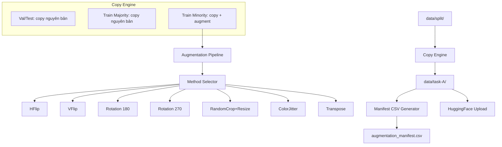

# Design Document: Task A Augmentation Pipeline

## Overview

Pipeline augmentation offline cho 2 lớp thiểu số (Podocarpaceae: 217 train, Taxaceae: 206 train) trong Task A (family-level classification). Pipeline sinh ảnh augmented dưới dạng file thực (real copies) tại `data/task-A/`, đưa mỗi lớp thiểu số lên 1,500-1,700 mẫu (tương đương mức Pinaceae: 1,666).

**Quyết định thiết kế chính:**
- Offline augmentation (sinh file thực) thay vì online augmentation — cho phép kiểm soát chất lượng, reproducibility, và chia sẻ qua HuggingFace
- Sử dụng `albumentations` cho augmentation pipeline vì hiệu suất cao và API linh hoạt cho ảnh lớn (2560x2048)
- Giữ nguyên resolution gốc — resize sẽ do training pipeline xử lý
- Notebook-centric workflow — toàn bộ pipeline chạy trong 1 notebook Colab-compatible

## Architecture



**Luồng xử lý chính:**

1. **Directory Setup** — Tạo cấu trúc `data/task-A/{split}/{family}/{species}/`
2. **Copy Phase** — Copy toàn bộ ảnh gốc (val, test, train majority) dưới dạng real files
3. **Augmentation Phase** — Sinh ảnh augmented cho train minority classes
4. **Manifest Phase** — Ghi manifest CSV với provenance đầy đủ
5. **Upload Phase** — Push lên HuggingFace Hub

## Components and Interfaces

### 1. AugmentationMethod (Enum)

```python
class AugmentationMethod(Enum):
    HFLIP = "hflip"
    VFLIP = "vflip"
    ROT180 = "rot180"
    ROT270 = "rot270"
    CROP_RESIZE = "crop_resize"
    COLOR_JITTER = "color_jitter"
    TRANSPOSE = "transpose"
```

### 2. AugmentationPipeline

Module chính thực hiện augmentation. Thiết kế stateless, nhận config và trả về ảnh augmented.

```python
class AugmentationPipeline:
    """Pipeline augmentation cho minority classes.
    
    Args:
        seed: Random seed cho reproducibility (default=42)
        target_count: Tuple (min, max) so luong mau muc tieu
        crop_min_area: Ti le dien tich toi thieu khi crop (default=0.7)
        color_params: Dict cau hinh ColorJitter
    """
    
    def __init__(self, seed: int = 42, 
                 target_count: tuple = (1500, 1700),
                 crop_min_area: float = 0.7,
                 color_params: dict = None): ...
    
    def get_transform(self, method: AugmentationMethod) -> A.Compose:
        """Tra ve albumentations transform cho method cu the."""
        ...
    
    def augment_image(self, image: np.ndarray, 
                      method: AugmentationMethod) -> np.ndarray:
        """Ap dung 1 augmentation method len 1 anh."""
        ...
    
    def compute_augmentation_plan(self, 
                                   original_count: int,
                                   target_count: int) -> List[Tuple[int, AugmentationMethod]]:
        """Tinh toan plan: anh nao duoc augment bang method nao.
        
        Phan phoi deu cac method across images.
        Returns: List of (image_index, method) tuples
        """
        ...
```

### 3. DirectoryCopier

```python
class DirectoryCopier:
    """Copy files tu data/split/ sang data/task-A/ dang real files."""
    
    def copy_split(self, src_root: Path, dst_root: Path, 
                   split: str, families: List[str]) -> int:
        """Copy toan bo anh cua 1 split. Returns so file da copy."""
        ...
```

### 4. ManifestWriter

```python
class ManifestWriter:
    """Ghi manifest CSV theo doi provenance."""
    
    def __init__(self, output_path: Path): ...
    
    def add_entry(self, original_path: str, augmented_path: str,
                  method: str, family: str, species: str): ...
    
    def save(self) -> Path:
        """Ghi CSV voi columns: original_path, augmented_path, method, family, species"""
        ...
```

### 5. Notebook Cells Structure

| Cell | Noi dung | Colab-only? |
|------|----------|-------------|
| 1 | Root Detection + sys.path | Khong |
| 2 | Install dependencies | Co (guard) |
| 3 | Download source dataset tu HuggingFace | Co (guard) |
| 4 | Import + Config (seed, target, methods) | Khong |
| 5 | Directory setup + copy engine | Khong |
| 6 | Augmentation pipeline execution | Khong |
| 7 | Manifest CSV generation | Khong |
| 8 | QA Summary table | Khong |
| 9 | Upload to HuggingFace | Khong |

## Data Models

### Directory Structure

```
data/task-A/
├── train/
│   ├── Cupressaceae/
│   │   ├── Cunninghamia lanceolata/
│   │   │   ├── img001.png
│   │   │   └── ...
│   │   └── .../
│   ├── Pinaceae/
│   │   └── .../
│   ├── Podocarpaceae/
│   │   └── Podocarpus pilgeri/
│   │       ├── img001.png              (original copy)
│   │       ├── img001_aughflip_0.png   (augmented)
│   │       ├── img001_augvflip_1.png   (augmented)
│   │       └── ...
│   └── Taxaceae/
│       └── Taxus wallichiana/
│           ├── img001.png
│           ├── img001_augrot180_0.png
│           └── ...
├── val/
│   └── ... (original copies only)
└── test/
    └── ... (original copies only)
```

### Augmented File Naming Convention

```
{original_stem}_aug{method}_{idx}.{ext}
```

- `original_stem`: Ten file goc khong co extension
- `method`: Ten method viet lien (hflip, vflip, rot180, rot270, crop_resize, color_jitter, transpose)
- `idx`: Index tuong ung voi lan augment (0-based)
- `ext`: png (giu nguyen format goc)

### Manifest CSV Schema

| Column | Type | Description |
|--------|------|-------------|
| original_path | str | Relative path tu data/task-A/ den file goc |
| augmented_path | str | Relative path tu data/task-A/ den file augmented |
| method | str | Ten augmentation method da ap dung |
| family | str | Ten ho thuc vat |
| species | str | Ten loai |

### Augmentation Parameters

| Method | albumentations Transform | Parameters |
|--------|--------------------------|------------|
| HFlip | A.HorizontalFlip | p=1.0 |
| VFlip | A.VerticalFlip | p=1.0 |
| Rotation 180 | A.Rotate | limit=(180, 180), p=1.0 |
| Rotation 270 | A.Rotate | limit=(270, 270), p=1.0 |
| RandomCrop+Resize | A.RandomResizedCrop | height=2048, width=2560, scale=(0.7, 0.9) |
| ColorJitter | A.ColorJitter | brightness=0.15, contrast=0.15, saturation=0.1, hue=0.05 |
| Transpose | A.Transpose | p=1.0 |

**ColorJitter rationale:** Moderate params (brightness/contrast 0.15, saturation 0.1, hue 0.05) giu wood grain visibility. Gia tri nho hon transforms.py (0.2) vi day la offline augmentation — training pipeline se ap dung them online augmentation.

**RandomCrop+Resize rationale:** scale=(0.7, 0.9) dam bao crop it nhat 70% dien tich goc, giu du chi tiet giai phau (resin canals, tracheids).

### Augmentation Count Calculation

```
Podocarpaceae: 217 originals -> target 1,600 -> need ~1,383 augmented images
  Per method: 1,383 / 7 methods = ~197 images/method
  
Taxaceae: 206 originals -> target 1,600 -> need ~1,394 augmented images
  Per method: 1,394 / 7 methods = ~199 images/method
```

Method distribution strategy: Round-robin assignment across methods, cycling through original images. Moi anh goc se duoc augment nhieu lan voi cac method khac nhau.

## Correctness Properties

*A property is a characteristic or behavior that should hold true across all valid executions of a system — essentially, a formal statement about what the system should do. Properties serve as the bridge between human-readable specifications and machine-verifiable correctness guarantees.*

### Property 1: No symlinks in output

*For any* file in the `data/task-A/` directory tree, it SHALL be a real file (not a symbolic link). `os.path.islink(file_path)` must return `False` for every file.

**Validates: Requirements 1.2**

### Property 2: Non-augmented files are byte-identical copies

*For any* image file in val/test splits, or any image file in train split belonging to a majority class (Cupressaceae, Pinaceae), the file SHALL be byte-identical to its corresponding source file in `data/split/`.

**Validates: Requirements 1.3, 1.4**

### Property 3: Augmented file naming and method validity

*For any* augmented file in the output directory, its filename SHALL match the pattern `{original_stem}_aug{method}_{idx}.png` where `method` is exactly one of: `hflip`, `vflip`, `rot180`, `rot270`, `crop_resize`, `color_jitter`, `transpose`. No other method values shall appear.

**Validates: Requirements 2.2, 2.3, 2.4**

### Property 4: Resolution preservation

*For any* augmented image file produced by the pipeline, its dimensions SHALL be exactly 2560x2048 pixels (width x height), identical to the original source images.

**Validates: Requirements 2.5, 2.6**

### Property 5: Uniform method distribution

*For any* minority class (Podocarpaceae, Taxaceae), the count of augmented images per method SHALL not deviate more than 15% from the mean count per method. Formally: `|count(method_i) - mean_count| / mean_count <= 0.15` for all methods.

**Validates: Requirements 3.1**

### Property 6: PNG format validity

*For any* augmented file produced by the pipeline, it SHALL have a `.png` extension and SHALL be a valid PNG file (readable by PIL/Pillow without error).

**Validates: Requirements 3.4**

### Property 7: Manifest completeness

*For any* augmented file in `data/task-A/train/`, there SHALL exist exactly one corresponding entry in `augmentation_manifest.csv` where the `augmented_path` column matches the file's relative path.

**Validates: Requirements 6.2**

### Property 8: Reproducibility (deterministic output)

*For any* input image and augmentation method, running the pipeline twice with `seed=42` SHALL produce byte-identical output files. The pipeline is a deterministic function of (image, method, seed).

**Validates: Requirements 6.4**

## Error Handling

| Scenario | Handling |
|----------|----------|
| Source image corrupt / unreadable | Log warning, skip image, continue pipeline. Report skipped count in summary. |
| Disk space insufficient | Check available space before starting. Estimate needed: ~(1400 * 2 classes * 15MB avg) = ~42GB. Raise early error if insufficient. |
| HuggingFace auth failure | Catch `HfHubHTTPError`, display message instructing `huggingface-cli login`. Do not crash notebook. |
| HuggingFace upload timeout | Retry up to 3 times with exponential backoff. Log progress per batch. |
| Target directory already exists | Ask user confirmation or skip if files already present (idempotent re-run support). |
| Augmented count exceeds target | Stop augmentation when target_count reached. Round-robin ensures even distribution even if stopped early. |

## Testing Strategy

### Unit Tests (example-based)

- Directory structure creation: verify all 4 families x 3 splits directories exist
- Target count validation: verify minority classes reach [1500, 1700] range
- ColorJitter parameter configuration: verify moderate params match spec
- RandomCrop scale lower bound: verify >= 0.7
- Manifest CSV schema: verify correct columns and non-empty after execution
- Notebook structure: verify Root Detection cell, Colab guards, no hard-coded paths

### Property-Based Tests (Hypothesis)

Library: **Hypothesis** (Python PBT library)
Configuration: minimum 100 examples per property

Each property test will:
1. Generate random file selections from the output directory
2. Verify the property holds for each selected file
3. Tag with design property reference

```python
# Tag format example:
# Feature: task-a-augmentation, Property 1: No symlinks in output
```

**Test structure:**
- Property 1-2: File system properties (symlinks, byte-identity) — sample random files from output
- Property 3: Naming convention — parse all augmented filenames with regex
- Property 4: Resolution — open random augmented images, check dimensions
- Property 5: Distribution — compute method counts from manifest, verify uniformity
- Property 6: PNG validity — open random augmented files with PIL
- Property 7: Manifest completeness — cross-reference filesystem with CSV
- Property 8: Determinism — re-run augmentation on random subset, compare outputs

### Integration Tests

- HuggingFace upload: mock `huggingface_hub.upload_folder`, verify correct arguments
- End-to-end pipeline: run on small subset (5 images per minority class), verify full workflow

### Test Execution

```bash
# Unit + property tests
pytest tests/test_augmentation_pipeline.py -v

# Property tests only (with verbose shrinking)
pytest tests/test_augmentation_properties.py -v --hypothesis-show-statistics
```

