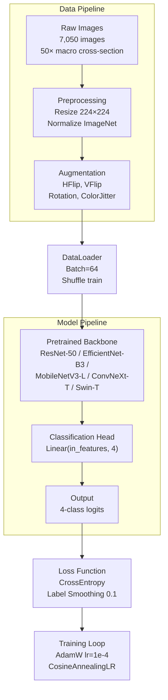

# System Design & Architecture — Task A: Conifer Family Classification

## Architecture Overview

### High-Level Pipeline



### Technology Stack

| Component | Technology | Version | Rationale |
|-----------|------------|---------|-----------|
| Deep Learning Framework | PyTorch | 2.x | Standard, mature ecosystem |
| Pretrained Models | timm | latest | Unified API for all backbones |
| Image Augmentation | torchvision / albumentations | latest | GPU-accelerated transforms |
| Metrics | scikit-learn | latest | F1, Precision, Recall, Confusion Matrix |
| Efficiency Profiling | ptflops / thop | latest | FLOPs calculation |
| Visualization | matplotlib, seaborn | latest | Plots, Grad-CAM |
| Experiment Tracking | wandb | latest | Cloud sync, free tier, best UI |

### Data Flow

```
Dataset Structure (2-level hierarchy):
data/
├── train/
│   ├── Cupressaceae/
│   │   ├── cunninghamia_lanceolata/
│   │   ├── callitris_columellaris/
│   │   └── ... (9 species)
│   ├── Pinaceae/
│   │   ├── pinus_dalatensis/
│   │   ├── pinus_radiata/
│   │   └── ... (8 species)
│   ├── Podocarpaceae/
│   │   └── podocarpus_pilgeri/
│   └── Taxaceae/
│       └── taxus_wallichiana/
├── val/ (same structure)
└── test/ (same structure)

Task A Label Extraction:
- Read parent folder name as family label
- Map: folder_name → class_index (0-3)
```

---

## Data Models

### Dataset Statistics

| Family | # Species | # Train Images | # Val Images | # Test Images | Total |
|--------|-----------|----------------|--------------|---------------|-------|
| Cupressaceae | 10 | ~3,500 | ~750 | ~750 | ~5,000 |
| Pinaceae | 8 | ~2,200 | ~470 | ~470 | ~3,140 |
| Podocarpaceae | 1 | ~217 | ~46 | ~47 | ~310 |
| Taxaceae | 1 | ~207 | ~44 | ~44 | ~295 |
| **Total** | 20 | ~4,935 | ~1,057 | ~1,058 | ~7,050 |

**Note**: Exact per-family counts depend on Phase 0 stratified split decision.

### Label Mapping

```python
FAMILY_LABELS = {
    0: "Cupressaceae",
    1: "Pinaceae", 
    2: "Podocarpaceae",
    3: "Taxaceae"
}

SPECIES_TO_FAMILY = {
    # Cupressaceae
    "cunninghamia_lanceolata": 0,
    "callitris_columellaris": 0,
    "fokienia_hodginsii": 0,
    "cupressus_funebris": 0,
    "calocedrus_sp": 0,
    "cryptomeria_japonica": 0,
    "xanthocyparis_vietnamensis": 0,
    "chamaecyparis_obtusa": 0,
    "calocedrus_rupestris": 0,
    "thujopsis_dolabrata": 0,
    # Pinaceae
    "pinus_dalatensis": 1,
    "pinus_radiata": 1,
    "pinus_sp": 1,
    "pinus_krempfii": 1,
    "picea_lauca": 1,
    "araucaria_araucana": 1,
    "pseudotsuga_brevifolia": 1,
    "pinus_cernua": 1,
    # Podocarpaceae
    "podocarpus_pilgeri": 2,
    # Taxaceae
    "taxus_wallichiana": 3,
}
```

### Model Checkpoint Structure

```python
@dataclass
class ModelCheckpoint:
    model_name: str          # e.g., "resnet50_taskA"
    backbone: str            # e.g., "resnet50"
    task: str                # "taskA" (family-level)
    family_classes: List[str] # ["Cupressaceae", "Pinaceae", "Podocarpaceae", "Taxaceae"]
    
    # Architecture
    pretrained: bool         # True (ImageNet)
    frozen_backbone: bool   # True (only head trained)
    in_features: int         # From backbone
    num_classes: int         # 4
    
    # Training config
    epochs: int              # 50
    batch_size: int           # 64
    learning_rate: float     # 1e-4
    weight_decay: float       # 1e-4 (default)
    label_smoothing: float   # 0.1
    
    # Results
    best_val_acc: float
    best_epoch: int
    test_metrics: Dict[str, float]
    
    # Paths
    checkpoint_path: Path
    config_path: Path
    
    # Metadata
    seed: int
    timestamp: str
    device: str
```

---

## API Design

### Training API

```python
# src/train_taskA.py

def train_taskA(
    backbone_name: str,           # "resnet50" | "efficientnet_b3" | "mobilenetv3_large" | "convnext_tiny" | "swin_tiny"
    data_root: Path,              # Path to dataset folder
    output_dir: Path,             # Where to save checkpoints/logs
    task: str = "taskA",          # "taskA" for family classification
    num_classes: int = 4,
    
    # Training params
    epochs: int = 50,
    batch_size: int = 64,
    lr: float = 1e-4,
    label_smoothing: float = 0.1,
    weight_decay: float = 1e-4,
    scheduler: str = "cosine",     # "cosine" | "step" | "plateau"
    T_max: int = 50,               # Cosine annealing period
    
    # Augmentation
    use_90rotation: bool = False,  # Ablation toggle
    
    # Reproducibility
    seed: int = 42,
    num_seeds: int = 3,
    
    # Hardware
    device: str = "cuda",
    use_amp: bool = True,
) -> TrainingResults
```

### Evaluation API

```python
# src/eval_taskA.py

def evaluate_taskA(
    checkpoint_path: Path,
    data_root: Path,
    batch_size: int = 64,
    device: str = "cuda",
) -> EvaluationResults:
    """
    Returns:
        - accuracy: float
        - precision_macro: float
        - recall_macro: float
        - f1_macro: float
        - confusion_matrix: np.ndarray (4x4)
        - per_class_f1: Dict[str, float]
        - inference_time_ms: float  # per image
    """
```

### Efficiency Profiling API

```python
# src/profile_efficiency.py

def profile_model(
    model: nn.Module,
    input_size: Tuple[int, int] = (3, 224, 224),
    device: str = "cuda",
    num_runs: int = 100,
) -> EfficiencyMetrics:
    """
    Returns:
        - params_millions: float       # Total parameters
        - flops_giga: float            # GFLOPs
        - inference_time_ms: float     # ms per image, batch=1
        - model_size_mb: float          # File size in MB
        - vram_mb: float               # GPU memory during inference
    """
```

---

## Component Breakdown

### 1. Data Module (`src/data/`)

| Component | Responsibility | Public API |
|-----------|----------------|------------|
| `dataset.py` | ImageFolder with family label extraction | `ConiferDataset(data_root, split, transform)` |
| `transforms.py` | Augmentation pipelines | `get_train_transforms()`, `get_val_transforms()` |
| `splitter.py` | Stratified split logic | `create_stratified_split()` |

### 2. Model Module (`src/models/`)

| Component | Responsibility | Public API |
|-----------|----------------|------------|
| `factory.py` | Create pretrained backbone + head | `create_model(backbone, num_classes, pretrained=True)` |
| `heads.py` | Classification head variants | `LinearHead`, `DropoutHead` |
| `utils.py` | Model loading/saving | `load_checkpoint()`, `save_checkpoint()` |

### 3. Training Module (`src/train/`)

| Component | Responsibility | Public API |
|-----------|----------------|------------|
| `trainer.py` | Main training loop | `train_one_epoch()`, `validate()` |
| `optimizer.py` | Optimizer + scheduler setup | `create_optimizer()`, `create_scheduler()` |
| `loss.py` | Loss functions | `LabelSmoothingCrossEntropy` |
| `callbacks.py` | Checkpointing, early stopping | `ModelCheckpoint`, `EarlyStopping` |

### 4. Evaluation Module (`src/eval/`)

| Component | Responsibility | Public API |
|-----------|----------------|------------|
| `metrics.py` | Calculate all metrics | `compute_metrics()` |
| `confusion.py` | Confusion matrix analysis | `plot_confusion_matrix()` |
| `gradcam.py` | Grad-CAM visualization | `generate_gradcam()` |

### 5. Profiling Module (`src/profile/`)

| Component | Responsibility | Public API |
|-----------|----------------|------------|
| `efficiency.py` | Measure time/size/FLOPs | `profile_model()` |
| `benchmark.py` | Run all models through benchmark | `benchmark_all_models()` |

---

## Design Decisions

### 1. Frozen Backbone, Trainable Head

**Decision**: Freeze ImageNet pretrained backbone, only train classification head.

**Rationale**:
- Macroscopic wood textures are well-captured by ImageNet features
- Faster training (no gradient computation through backbone)
- Reduced GPU memory → larger batch size possible
- Standard practice for transfer learning benchmarks

**Trade-off**: May not fine-tune domain-specific features as well as full fine-tuning.

### 2. Standard 224×224 Input Size

**Decision**: Use 224×224 for all models (standard ImageNet size).

**Rationale**:
- All 5 backbones have pretrained weights at 224×224
- Fair comparison between architectures
- Faster training and inference

**Trade-off**: Higher resolution (384px) might improve accuracy for fine-grained wood textures.

### 3. Label Smoothing = 0.1

**Decision**: Use label smoothing 0.1 for regularization.

**Rationale**:
- Prevents overconfident predictions
- Improves calibration
- Standard in modern classification benchmarks

### 4. 90° Rotation Ablation (Discrete)

**Decision**: Test discrete 90° rotation augmentation explicitly.

**Rationale**:
- Cross-section images are isotropic (no natural orientation)
- Hypothesis: 0°, 90°, 180°, 270° rotations preserve semantic information
- Verify this assumption experimentally with discrete orientations

**Implementation**: During training, randomly select one of 4 discrete rotations (0°, 90°, 180°, 270°) with equal probability.

### 5. AMP (Automatic Mixed Precision)

**Decision**: Enable AMP for training.

**Rationale**:
- ~2x speedup on modern GPUs (RTX 3080+)
- Reduced VRAM usage
- Minimal accuracy impact (FP16 is sufficient for gradients)

---

## Multi-Seed Training Workflow

### Strategy: Sequential Seeds

```
┌─────────────────────────────────────────────────────────┐
│  Training Script (train_taskA.py)                      │
│                                                         │
│  for seed in [42, 123, 456]:                            │
│      set_random_seed(seed)                              │
│      train_model(...)                                   │
│      save_checkpoint(seed=seed)                         │
│                                                         │
│  aggregate_results(seeds=[42, 123, 456])                │
│  → outputs: mean ± std for all metrics                 │
└─────────────────────────────────────────────────────────┘
```

### Results Aggregation

```python
def aggregate_results(checkpoint_paths: List[Path]) -> Dict[str, Dict]:
    """
    Aggregate metrics across seeds.
    
    Returns:
        {
            "accuracy": {"mean": 0.97, "std": 0.005},
            "f1_macro": {"mean": 0.96, "std": 0.008},
            ...
        }
    """
```

### Experiment Tracking (wandb)

- Each seed run → separate wandb run
- Group by: `taskA-{model_name}` for easy comparison
- Tags: `seed=42`, `seed=123`, `seed=456`

---

## Non-Functional Requirements

### Performance Targets

| Metric | Target | Notes |
|--------|--------|-------|
| Training Time | <4 hours/model | On RTX 3080+ |
| Inference Time | <50ms/image | Batch=1, GPU |
| Memory Usage | <8GB VRAM | During training |
| Model Size | <100MB | For lightweight models |

### Scalability Considerations

- Code structure supports Task B (20-class) with minimal changes
- Config-driven: change `num_classes` and `task` parameter
- Experiment tracking: wandb/tensorboard for comparing runs

### Reliability

- Seed-based reproducibility: 3 seeds per experiment
- Checkpointing: save best model based on validation accuracy
- Logging: detailed training logs for debugging

### Reproducibility

```bash
# Required environment for reproducibility
torch>=2.0.0
torchvision>=0.15.0
python>=3.10
cuda>=12.0

# Environment snapshot
pip freeze > requirements.txt
```

---

## Grad-CAM Configuration Per Model

| Model | Target Layer | Notes |
|-------|-------------|-------|
| ResNet-50 | `layer4[-1].conv3` | Last conv block |
| EfficientNet-B3 | `features[-1]` | Final feature block |
| MobileNetV3-Large | `features[-1]` | Last SE block |
| ConvNeXt-Tiny | `features[-1]` | Final stage |
| Swin-T | `layers[-1].blocks[-1].norm1` | After last transformer block |

---

## File Structure

```
woodbench/
├── src/
│   ├── __init__.py
│   ├── data/
│   │   ├── __init__.py
│   │   ├── dataset.py          # ConiferDataset class
│   │   ├── transforms.py       # Augmentation pipelines
│   │   └── splitter.py         # Stratified split
│   ├── models/
│   │   ├── __init__.py
│   │   ├── factory.py          # Model creation
│   │   └── heads.py            # Classification heads
│   ├── train/
│   │   ├── __init__.py
│   │   ├── trainer.py          # Training loop
│   │   ├── optimizer.py        # Optimizer setup
│   │   └── callbacks.py       # Checkpointing
│   ├── eval/
│   │   ├── __init__.py
│   │   ├── metrics.py          # Evaluation metrics
│   │   ├── confusion.py        # Confusion matrix
│   │   └── gradcam.py         # Grad-CAM
│   └── profile/
│       ├── __init__.py
│       └── efficiency.py       # Profiling
├── configs/
│   ├── taskA_baseline.yaml     # Standard config
│   └── taskA_90rotation.yaml  # Ablation config
├── experiments/
│   └── taskA/
│       ├── resnet50/
│       ├── efficientnet_b3/
│       ├── mobilenetv3_large/
│       ├── convnext_tiny/
│       └── swin_tiny/
├── data/                      # Symlink to dataset
└── requirements.txt
```
