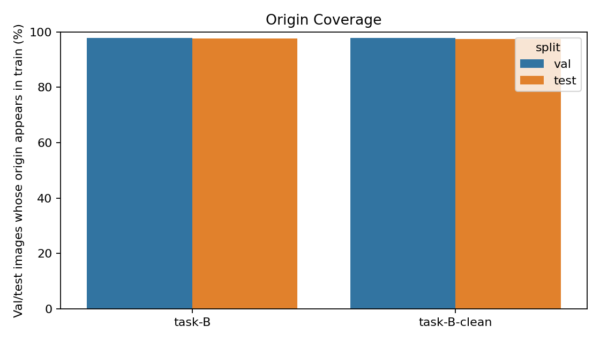

# WoodID-S2-2026 — Phase 1 Leakage Origin Investigation Report

Notebook nguồn: `notebooks/phase 1/WoodID_Phase1_Leakage_Origin_Investigation.ipynb`

Thư mục kết quả: `docs/reports/phase_1_leakage_origin_investigation/`

## 1. Tóm Tắt Dễ Hiểu

Kết quả Phase 1 có nhiều run đạt `100% best_val_acc`, đặc biệt là ConvNeXt-Tiny và Swin-Tiny trên Task B. Con số này nhìn rất tốt, nhưng sau khi kiểm tra dữ liệu, nguyên nhân có khả năng lớn không phải là mô hình đã nhận dạng gỗ hoàn hảo. Nguyên nhân chính là validation/test có nhiều ảnh thuộc cùng mẫu gốc với train.

Nói đơn giản: một mẫu gỗ ban đầu có thể được cắt thành nhiều ảnh nhỏ. Nếu một vài crop của mẫu đó nằm trong train, còn crop khác của cùng mẫu nằm trong val/test, thì model đã nhìn thấy "người quen" khi học. Khi đánh giá, nó không hoàn toàn phải nhận dạng mẫu gỗ mới, mà nhiều lúc chỉ cần nhận lại texture rất giống mẫu đã học.

Kết luận chính:

- `data/task-B` có exact duplicate leakage: 120 nhóm ảnh trùng MD5 giữa các split.
- `data/task-B-clean` đã sạch exact duplicate, nhưng vẫn còn origin/specimen leakage rất cao.
- Trong `task-B-clean`, khoảng 97% ảnh val/test có origin đã xuất hiện trong train.
- Vì vậy, `100% val acc` hiện tại chưa nên được xem là bằng chứng generalization mạnh.
- Cần tạo lại split theo `origin_key`, tức là mọi crop từ cùng mẫu gốc phải nằm cùng một split.

## 2. Giải Thích Thuật Ngữ

Mục này dành cho người đọc chưa có context về dataset hoặc machine learning. Nếu chỉ cần kết luận, có thể đọc phần tóm tắt ở trên; nếu muốn hiểu vì sao report nghi ngờ `100% val acc`, nên đọc kỹ các thuật ngữ dưới đây.

### Origin / Specimen / Mẫu Gốc

`Origin` hoặc `specimen` trong report này nghĩa là **mẫu gỗ gốc ban đầu**. Có thể hiểu đó là một miếng gỗ, một lát cắt, một ảnh lớn ban đầu, hoặc một nguồn chụp gốc trước khi sinh ra nhiều ảnh nhỏ.

Ví dụ, một mẫu gỗ Araucaria araucana có thể có nhiều ảnh crop:

```text
3351. Araucaria araucana.1.(1).png
3351. Araucaria araucana.1.(12).png
3351. Araucaria araucana.1.(20).png
3351. Araucaria araucana.1.(31).png
```

Các file này là các ảnh khác nhau, nhưng đều đến từ cùng mẫu gốc:

```text
3351. Araucaria araucana.1.
```

Nói ngắn gọn:

```text
origin/specimen = mẫu gỗ gốc
crop = ảnh nhỏ được cắt ra từ mẫu gỗ gốc đó
```

### Origin Key

`origin_key` là khóa mà notebook tạo ra để gom các ảnh thuộc cùng mẫu gốc. Notebook lấy tên file và bỏ phần chỉ số crop ở cuối, ví dụ bỏ `(12)`, `(20)`, `(31)`.

Ví dụ:

```text
filename:
3351. Araucaria araucana.1.(12).png

origin_key:
Araucaria araucana::3351. Araucaria araucana.1.
```

Phần trước dấu `::` là tên class/loài. Phần sau dấu `::` là định danh mẫu gốc. Thêm tên class vào `origin_key` để tránh nhầm các file trùng tên giữa các loài khác nhau.

### Crop

`Crop` là ảnh nhỏ được cắt ra từ một ảnh hoặc mẫu lớn hơn. Trong dataset gỗ, cùng một mặt cắt gỗ có thể được chia thành nhiều vùng nhỏ để tăng số lượng ảnh huấn luyện.

Crop khác nhau có thể không giống hệt từng pixel, nhưng vẫn rất giống nhau về cấu trúc vân gỗ, texture, ánh sáng, hướng cắt và đặc điểm mẫu.

### Split: Train / Val / Test

`Split` là cách chia dataset thành 3 phần:

- `train`: dữ liệu cho model học.
- `val` hoặc validation: dữ liệu dùng để chọn checkpoint, theo dõi overfitting và dừng sớm.
- `test`: dữ liệu dùng để báo cáo kết quả cuối cùng.

Nguyên tắc lý tưởng: val/test phải đại diện cho dữ liệu mới mà model chưa từng thấy trong train.

### Leakage

`Leakage` là rò rỉ dữ liệu giữa train và val/test. Nghĩa là thông tin đáng lẽ chỉ nằm ở val/test lại xuất hiện trong train.

Ví dụ leakage rõ ràng:

```text
train có ảnh A.png
val cũng có ảnh A.png hoặc ảnh giống hệt A.png
```

Ví dụ leakage tinh vi hơn:

```text
train có crop từ mẫu gỗ A
val/test cũng có crop khác từ cùng mẫu gỗ A
```

Trường hợp thứ hai là `origin/specimen leakage`. Đây là vấn đề chính của report.

### Exact Duplicate

`Exact duplicate` là ảnh trùng chính xác về nội dung file hoặc gần như cùng một ảnh. Notebook dùng MD5 để phát hiện loại này.

Nếu hai ảnh có cùng MD5, nghĩa là nội dung nhị phân của file giống nhau. Đây là loại trùng dễ phát hiện.

### MD5

`MD5` là một mã hash được tính từ nội dung file. Có thể hiểu đơn giản là "dấu vân tay" của file.

Nếu hai file ảnh có cùng MD5:

```text
ảnh 1 -> MD5 abc123
ảnh 2 -> MD5 abc123
```

thì hai file đó có nội dung giống nhau. Tuy nhiên, nếu hai ảnh là hai crop khác nhau từ cùng mẫu gốc, MD5 thường sẽ khác nhau. Vì vậy MD5 không bắt được origin/specimen leakage.

### Origin Coverage

`Origin coverage` trả lời câu hỏi:

> Trong val/test, bao nhiêu ảnh có mẫu gốc đã xuất hiện trong train?

Ví dụ val có 100 ảnh. Nếu 97 ảnh trong đó có origin đã xuất hiện ở train, origin coverage là 97%.

Coverage cao nghĩa là val/test không còn độc lập theo mẫu gốc. Trong report này, `task-B-clean` có coverage khoảng 97%, nên validation accuracy rất dễ bị inflate.

### Group Split

`Group split` là cách chia dữ liệu theo nhóm origin, không chia từng ảnh riêng lẻ.

Split chưa tốt:

```text
train: crop 1, crop 2 của mẫu A
val:   crop 3 của mẫu A
test:  crop 4 của mẫu A
```

Split tốt hơn:

```text
train: toàn bộ crop của mẫu A
val:   toàn bộ crop của mẫu B
test:  toàn bộ crop của mẫu C
```

Nghĩa là một origin chỉ được nằm trong một split duy nhất.

### 1-NN Retrieval

`1-NN` là viết tắt của `1-nearest neighbor`, tức "hàng xóm gần nhất".

Trong report này, 1-NN retrieval làm việc như sau:

1. Biến mỗi ảnh thành vector đặc trưng bằng model pretrained.
2. Với mỗi ảnh val/test, tìm ảnh train có vector gần nhất.
3. Kiểm tra ảnh train gần nhất đó có cùng loài hoặc cùng origin không.

Nếu chỉ cần tìm ảnh train gần nhất mà đã đoán đúng loài rất cao, điều đó cho thấy val/test rất giống train.

### Validation Accuracy, Test Accuracy, F1-Macro

`Validation accuracy` hoặc `val acc` là tỷ lệ dự đoán đúng trên tập validation. Nó thường được dùng trong quá trình train để chọn checkpoint tốt nhất.

`Test accuracy` là tỷ lệ dự đoán đúng trên tập test. Nó nên được dùng để báo cáo kết quả cuối cùng.

`F1-macro` là metric cân bằng hơn accuracy khi có nhiều class. Nó tính F1 cho từng class rồi lấy trung bình. Với Task B có 20 loài, F1-macro hữu ích vì nó tránh việc model chỉ tốt trên các class nhiều ảnh.

### Inflated Metric

`Metric bị inflate` nghĩa là điểm số cao hơn thực lực generalization thật. Không phải code tính metric sai, mà là bộ đánh giá quá dễ hoặc bị rò rỉ thông tin từ train.

Trong report này, `100% val acc` có khả năng bị inflate vì phần lớn val/test có origin đã xuất hiện trong train.

### Generalization

`Generalization` là khả năng model dự đoán đúng trên dữ liệu mới, chưa từng gặp trong quá trình train.

Với bài toán nhận dạng gỗ, generalization tốt nghĩa là model nhận dạng đúng một mẫu gỗ mới, không chỉ nhận ra crop khác của mẫu gỗ đã học.

## 3. Vì Sao Cần Kiểm Tra Lại?

Theo tài liệu gốc WoodID-S2-2026, đề tài là một benchmark nghiêm túc cho 20 loài gỗ lá kim, với mục tiêu báo cáo kết quả Task A, Task B, ablation và efficiency. Phần dataset trong kế hoạch yêu cầu split 70/15/15 stratified theo species. Điều này đúng ở mức class balance, nhưng chưa đủ nếu mỗi species gồm nhiều crop từ cùng specimen.

Một benchmark tốt cần trả lời câu hỏi:

> Khi gặp một mẫu gỗ mới chưa từng thấy, model có nhận dạng đúng loài không?

Nếu train và val/test cùng chứa crop từ một mẫu gỗ, câu hỏi thực tế bị đổi thành:

> Khi gặp một crop khác của mẫu gỗ đã từng thấy, model có nhận ra không?

Hai câu hỏi này rất khác nhau. Câu thứ hai dễ hơn nhiều.

## 4. Notebook Đã Làm Gì?

Notebook tạo một manifest cho từng ảnh trong `data/task-B` và `data/task-B-clean`, gồm:

- `dataset`: tên dataset, ví dụ `task-B-clean`.
- `split`: `train`, `val`, hoặc `test`.
- `class_name`: tên loài.
- `filename`: tên file ảnh.
- `origin_key`: khóa đại diện cho mẫu gốc.
- `md5`: hash nội dung ảnh.
- `path`: đường dẫn ảnh.

Ví dụ:

```text
3351. Araucaria araucana.1.(12).png
3351. Araucaria araucana.1.(20).png
3351. Araucaria araucana.1.(31).png
```

Các file này khác nhau ở phần `(12)`, `(20)`, `(31)`. Notebook coi phần trước đó là mẫu gốc:

```text
Araucaria araucana::3351. Araucaria araucana.1.
```

Nếu origin này xuất hiện ở cả train và val/test, đó là origin/specimen leakage.

## 5. Kết Quả Chính

### 5.1 Số Lượng Ảnh

| Dataset        | Train | Val | Test |  Tổng |
| -------------- | ----: | --: | ---: | ----: |
| `task-B`       | 3,973 | 933 |  924 | 5,830 |
| `task-B-clean` | 3,795 | 926 |  851 | 5,572 |

`task-B-clean` ít ảnh hơn vì đã loại một phần ảnh trùng exact duplicate.

### 5.2 Exact Duplicate Leakage Bằng MD5

MD5 kiểm tra ảnh giống hệt nhau ở mức nội dung file. Nếu hai ảnh có cùng MD5, có thể coi là cùng ảnh hoặc nội dung ảnh giống hệt.

| Dataset        | Nhóm MD5 xuất hiện ở nhiều split | Số ảnh nằm trong các nhóm đó |
| -------------- | -------------------------------: | ---------------------------: |
| `task-B`       |                              120 |                          248 |
| `task-B-clean` |                                0 |                            0 |

Diễn giải:

- `task-B` bị leakage rõ ràng: có ảnh giống hệt nằm chéo train/val/test.
- `task-B-clean` đã xử lý được tầng leakage dễ thấy này.
- Nhưng MD5 chỉ bắt được ảnh giống hệt từng pixel. Nó không bắt được các crop khác nhau từ cùng mẫu gốc.

### 5.3 Origin/Specimen Leakage

Origin/specimen leakage kiểm tra trường hợp ảnh không giống hệt, nhưng là crop từ cùng mẫu gốc.

| Dataset        | Nhóm origin xuất hiện ở nhiều split | Số ảnh nằm trong các nhóm đó |
| -------------- | ----------------------------------: | ---------------------------: |
| `task-B`       |                                 361 |                        5,634 |
| `task-B-clean` |                                 361 |                        5,376 |

Đây là kết quả quan trọng nhất.

Ngay cả khi `task-B-clean` không còn exact duplicate, nó vẫn có 361 nhóm origin nằm chéo split. Với `task-B-clean`, 5,376 trên 5,572 ảnh thuộc các nhóm origin xuất hiện ở nhiều split. Tức là phần lớn ảnh đang không độc lập theo mẫu gốc.

Các kiểu overlap trong `task-B-clean`:

| Kiểu overlap     | Số nhóm origin |
| ---------------- | -------------: |
| `test,train,val` |            196 |
| `train,val`      |             88 |
| `test,train`     |             75 |
| `test,val`       |              2 |

Đáng chú ý nhất là 196 origin xuất hiện ở cả 3 split. Điều này làm train, val và test giống nhau về nguồn mẫu.

### 5.4 Origin Coverage

Origin coverage trả lời câu hỏi:

> Trong val/test, bao nhiêu ảnh có mẫu gốc đã xuất hiện trong train?

| Dataset        | Split | Số ảnh | Ảnh có origin đã thấy ở train | Coverage |
| -------------- | ----- | -----: | ----------------------------: | -------: |
| `task-B`       | val   |    933 |                           912 |   97.75% |
| `task-B`       | test  |    924 |                           902 |   97.62% |
| `task-B-clean` | val   |    926 |                           905 |   97.73% |
| `task-B-clean` | test  |    851 |                           829 |   97.41% |

Diễn giải:

- Gần 98% ảnh val/test trong cả hai dataset có mẫu gốc đã xuất hiện ở train.
- Điều này giải thích vì sao validation accuracy có thể lên 100% rất sớm.
- `clean` theo MD5 không làm giảm origin coverage, vì nó chỉ xóa ảnh giống hệt, không gom các crop cùng specimen.

Hình minh họa được lưu tại:



## 6. Liên Hệ Với Kết Quả Phase 1

Trong report Phase 1, Task B main có:

| Nhóm                       | Backbone      | Best Val Acc Mean | Test Acc Mean | Test F1 Mean |
| -------------------------- | ------------- | ----------------: | ------------: | -----------: |
| Task B main                | ConvNeXt-Tiny |            100.00 |         99.68 |        99.68 |
| Task B main                | Swin-Tiny     |            100.00 |         99.46 |        99.46 |
| Task B clean leakage-check | Swin-Tiny     |            100.00 |         99.76 |        99.76 |

Điều này có hai ý:

1. Validation đạt 100%, nhưng test vẫn không phải 100%.
2. Ngay cả clean run vẫn đạt 100% val, vì clean run mới xử lý duplicate theo MD5, chưa xử lý leakage theo origin/specimen.

Vậy `100% val acc` nên được trình bày là:

> Kết quả ban đầu trên split hiện có, có dấu hiệu bị inflate do origin-level leakage.

Không nên trình bày là:

> Model đã đạt hiệu năng hoàn hảo trên dữ liệu độc lập.

## 7. 1-NN Retrieval Baseline

Notebook có cell 1-NN retrieval baseline. Cách này không train model mới. Nó dùng embedding từ model pretrained rồi hỏi:

> Với mỗi ảnh val/test, ảnh train nào gần nhất?

Nếu ảnh train gần nhất thường cùng class hoặc cùng origin, thì dataset đang rất dễ nhận lại.

Kết quả sample hiện tại:

| Split | Nearest train cùng class | Nearest train cùng origin |
| ----- | -----------------------: | ------------------------: |
| val   |                   82.33% |                    28.33% |
| test  |                   84.00% |                    30.67% |

Độ tương đồng cosine trung bình:

| Split | Mean similarity |    Min |    Max |
| ----- | --------------: | -----: | -----: |
| val   |          0.9092 | 0.7089 | 0.9907 |
| test  |          0.9135 | 0.6853 | 0.9807 |

Diễn giải dễ hiểu:

- Chỉ cần tìm ảnh train gần nhất bằng embedding pretrained, hơn 82% val/test đã có nearest train cùng loài.
- Khoảng 28-31% val/test sample có nearest train cùng chính origin.
- Con số cùng origin trong 1-NN thấp hơn origin coverage vì nearest neighbor có thể là crop rất giống từ origin khác cùng class. Nhưng coverage cho biết origin đó có tồn tại trong train; 1-NN cho biết ảnh gần nhất trong sample train là gì.

Lưu ý: đây là baseline sample, không phải toàn bộ dataset. Nó vẫn đủ để củng cố nhận định rằng val/test rất gần train về mặt hình ảnh.

## 8. Re-Split Theo Group Là Gì?

Notebook đã tạo file:

```text
task-B-clean_group_split_plan.csv
```

File này không copy ảnh mặc định, chỉ tạo kế hoạch split mới. Nguyên tắc:

> Một `origin_key` chỉ được nằm trong một split duy nhất.

Kết quả kế hoạch split mới:

| New split | Số ảnh | Số origin |
| --------- | -----: | --------: |
| train     |  3,876 |       389 |
| val       |    903 |        90 |
| test      |    793 |        78 |

Kiểm tra quan trọng:

```text
cross new split origins = 0
```

Tức là trong kế hoạch mới, không còn origin nào bị chia sang nhiều split. Đây mới là kiểu split phù hợp để đánh giá generalization theo mẫu gỗ mới.

## 9. Cách Hiểu Bằng Ví Dụ

Giả sử ta có một mẫu gỗ A, được cắt thành 30 ảnh:

```text
A.(1).png
A.(2).png
...
A.(30).png
```

Split hiện tại có thể giống như:

```text
train: A.(1), A.(2), A.(3), ...
val:   A.(12), A.(20)
test:  A.(25), A.(30)
```

Như vậy val/test không còn là mẫu mới. Chúng chỉ là các crop khác của mẫu A.

Split đúng hơn cho mục tiêu benchmark:

```text
train: tất cả crop của mẫu A
val:   tất cả crop của mẫu B
test:  tất cả crop của mẫu C
```

Lúc đó model phải nhận dạng mẫu gỗ mới thật sự, không phải nhận lại mẫu quen.

## 10. Ý Nghĩa Với Paper/Report

Theo WoodID plan, contribution chính là benchmark hệ thống 5 kiến trúc deep learning trên Task A và Task B. Benchmark chỉ có giá trị nếu split đánh giá độc lập hợp lý.

Do đó, phần report nên điều chỉnh như sau:

1. Giữ kết quả Phase 1 hiện tại như preliminary result.
2. Ghi rõ đã phát hiện origin-level leakage trong split Task B.
3. Không dùng `100% val acc` làm claim chính.
4. Tạo lại dataset split theo origin/specimen.
5. Rerun ít nhất Task B main trên group split.
6. Sau khi có group-split result, mới chốt bảng kết quả chính cho paper.

Với ablation 90 rotation và label smoothing, nếu vẫn dùng split cũ thì kết quả có thể bị inflate. Nên rerun ablation trên split mới hoặc ít nhất rerun best model trước để đo mức ảnh hưởng.

## 11. Khuyến Nghị Hành Động

### Ưu tiên cao

Tạo dataset mới từ `task-B-clean_group_split_plan.csv`:

```text
data/task-B-group-split/
```

Sau đó kiểm lại:

- Không có MD5 overlap giữa splits.
- Không có `origin_key` overlap giữa splits.
- Val/test class distribution vẫn đủ ổn.

### Rerun tối thiểu

Chạy lại Task B với:

- `convnext_tiny`, seed 42.
- `swin_tiny`, seed 42.
- Sau đó thêm 3 seeds nếu thời gian cho phép.

Nếu accuracy giảm rõ so với split cũ, kết luận leakage được xác nhận mạnh.

### Rerun đầy đủ cho paper

Nếu mục tiêu là paper Q2/Q3, nên rerun:

- 5 backbones Task B trên group split.
- Best model Task B cho ablation 90 rotation.
- Label smoothing nếu còn dùng làm ablation chính.

Task A cũng nên kiểm origin leakage nếu nó dùng cùng nguồn split/crop logic.

## 12. Kết Luận Cuối

Notebook đã chỉ ra rằng vấn đề không dừng ở exact duplicate. `task-B-clean` đã hết duplicate theo MD5, nhưng vẫn còn leakage theo mẫu gốc ở mức rất cao. Khoảng 97% ảnh val/test có origin đã xuất hiện trong train.

Vì vậy, nguyên nhân hợp lý nhất cho `100% val acc` là validation set chưa độc lập theo specimen/source. Model nhiều khả năng đang học các đặc trưng rất gần với mẫu đã thấy, thay vì chứng minh khả năng nhận dạng mẫu gỗ hoàn toàn mới.

Kết luận nên dùng trong báo cáo:

> Kết quả Phase 1 ban đầu cho thấy các backbone mạnh đạt độ chính xác rất cao, nhưng phân tích leakage phát hiện split hiện tại bị trùng nguồn mẫu giữa train/val/test. Do đó cần tạo group split theo origin/specimen và đánh giá lại trước khi dùng kết quả làm benchmark chính.
